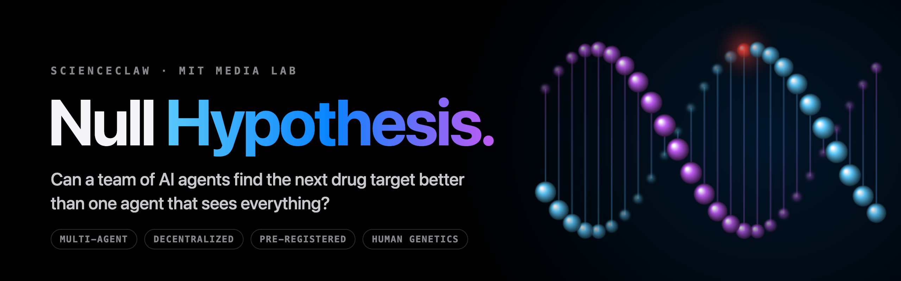
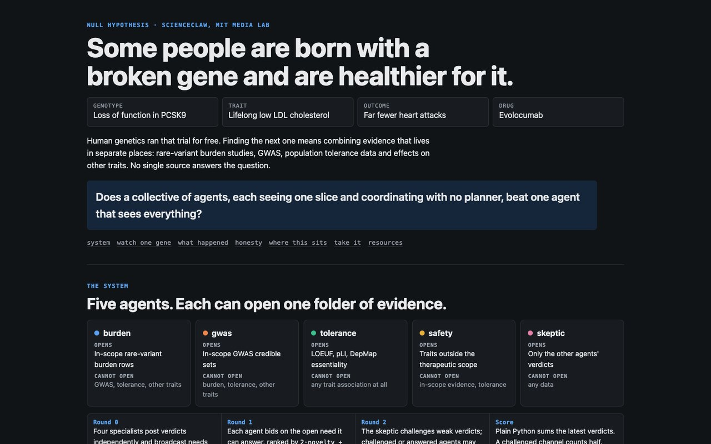
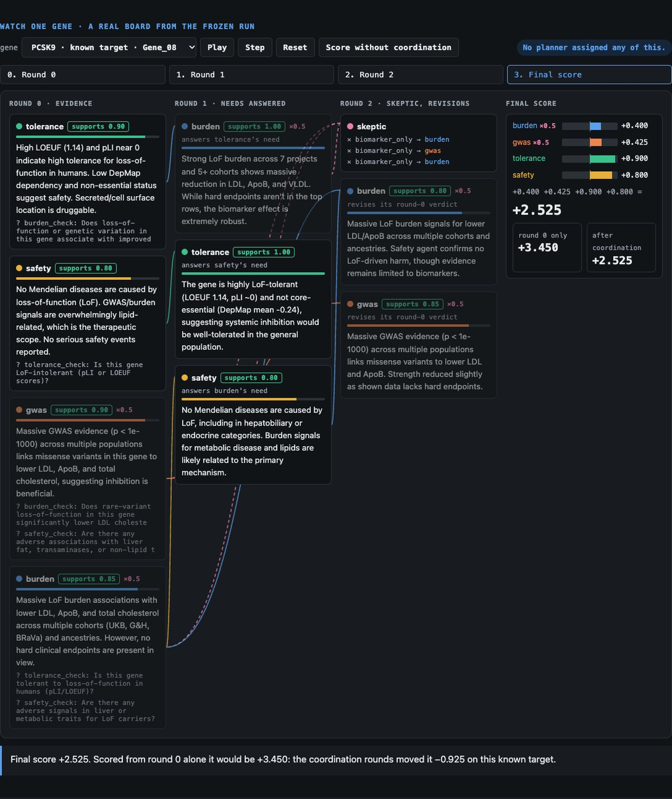
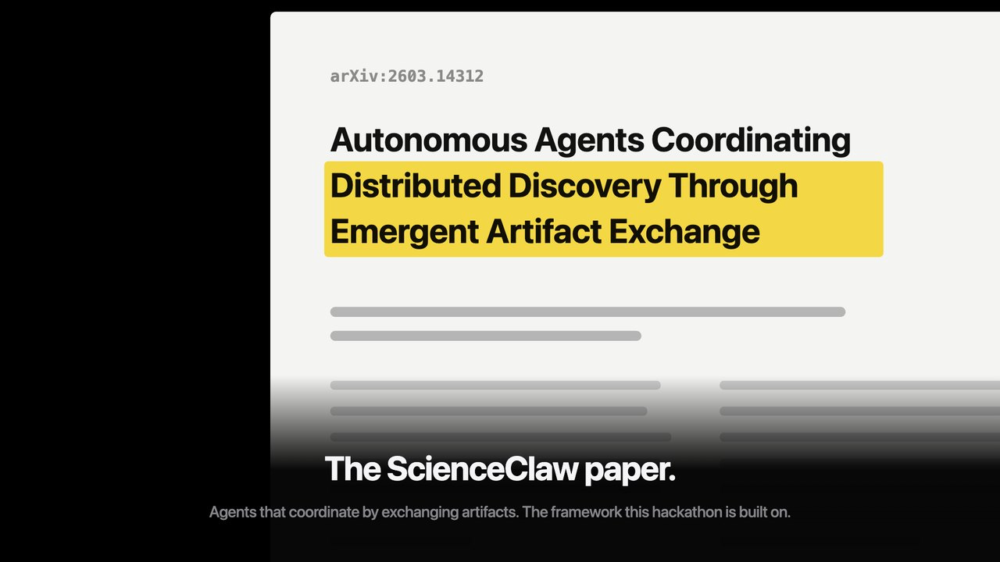
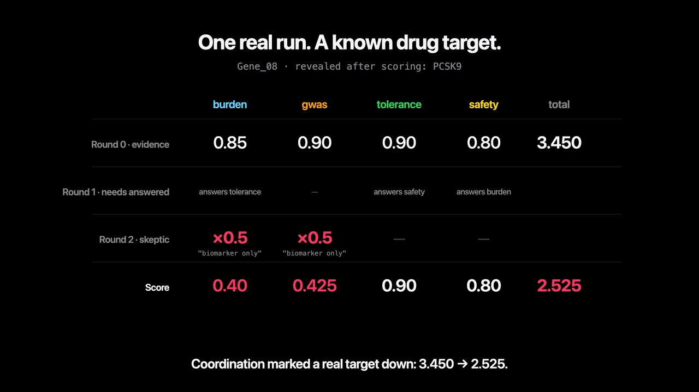
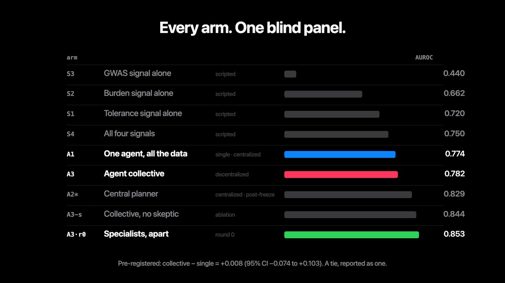
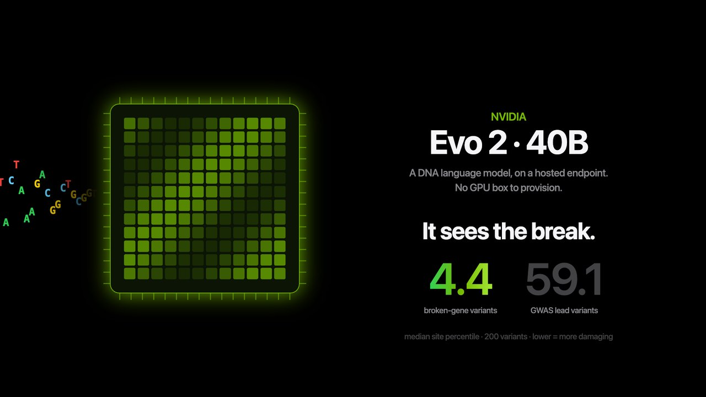
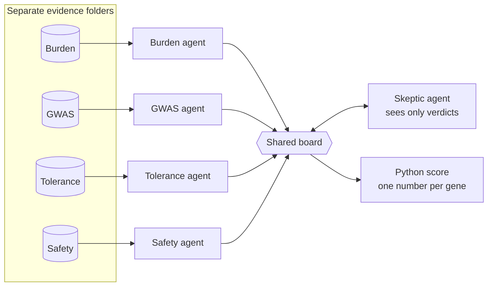

<p align="center">
  
</p>

<p align="center">
  <a href="https://karunprem45.github.io/null-hypothesis/"></a>
  <a href="site/null-hypothesis-keynote.mp4"></a>
  <a href="docs/Null_Hypothesis_Project_Report.pdf"></a>
</p>

<p align="center">
  
  <a href="frozen/"></a>
  
  
  <a href="LICENSE"></a>
  <br>
  
  
  
  
</p>

## Preview

<table>
  <tr>
    <td width="50%"><a href="https://karunprem45.github.io/null-hypothesis/"></a><br><sub><b>Live site:</b> the problem and the five agents</sub></td>
    <td width="50%"><a href="https://karunprem45.github.io/null-hypothesis/#replay"></a><br><sub><b>Replay:</b> a real PCSK9 board, round by round</sub></td>
  </tr>
  <tr>
    <td><br><sub><b>Film:</b> the ScienceClaw question</sub></td>
    <td><br><sub><b>Film:</b> coordination marks a real target down</sub></td>
  </tr>
  <tr>
    <td><br><sub><b>Film:</b> every arm on one blind panel</sub></td>
    <td><br><sub><b>Film:</b> NVIDIA Evo 2 sees the break</sub></td>
  </tr>
</table>

---

## The story in nine steps

### 1. Nature already ran the experiment

Some people are born with a broken copy of a gene, and they end up **healthier** for it. People with a broken **PCSK9** gene have low cholesterol all their lives and far fewer heart attacks. That discovery became a medicine, evolocumab. Human genetics ran the trial for free.

### 2. Finding the next one is hard

The clues for the next gene like PCSK9 are scattered across different datasets:

- **Burden studies:** do people with a broken copy get less disease?
- **GWAS:** does a second kind of study agree?
- **Tolerance:** can a person live normally without the gene?
- **Safety:** does breaking it cause harm somewhere else?

No single dataset answers the question on its own.

### 3. The ScienceClaw question

The [ScienceClaw paper](https://arxiv.org/abs/2603.14312) (*Autonomous Agents Coordinating Distributed Discovery Through Emergent Artifact Exchange*) asks a simple question:

> Is it better to have **one agent that sees everything**, or **many agents that each see a part** and coordinate without a boss?

That is **single vs collective**, and **centralized vs decentralized**. We tested it on real human genetics.

### 4. What we built

Five AI agents. Each one can open **only its own folder** of evidence, and **no planner** tells them what to do.



How a gene gets scored:

1. **Round 0:** each agent reads its own folder and posts a verdict, plus questions it can't answer itself.
2. **Round 1:** agents answer each other's questions. Nobody assigns the work; each agent picks the open question it can answer best.
3. **Round 2:** the skeptic challenges weak claims. A challenged channel counts half.
4. **Score:** plain Python adds up the latest verdicts.

We check that no agent can peek at another's data with **203 automated tests**. A planted leak makes them fail.

### 5. A fair, blind test

- **40 genes:** 12 real drug targets hidden among 28 look-alikes.
- **Names hidden:** agents only ever see codes like `Gene_08`.
- **Plan locked first:** the panel, the scoring rule and the metrics were frozen in git at commit `12b8c58` **before the first run**.

### 6. What happened

| Setup | Score (AUROC, 0.5 = coin flip, 1.0 = perfect) |
| --- | --- |
| One agent that sees everything (A1) | 0.774 |
| The agent collective, coordinating (A3) | 0.782 |
| A central planner choosing specialists *(added later)* | 0.829 |
| **The same specialists, before they talked** | **0.853** |

- **The pre-registered answer is a tie.** Collective minus single = **+0.008** (95% CI −0.074 to +0.103). We report it as one.
- **Talking made the specialists worse.** We reran the same genes 5 times. Coordinating lowered the score **in all 5 runs**: mean **−0.053** (95% CI −0.090 to −0.017).

### 7. Why: the skeptic didn't spare real targets

The skeptic's most common challenge ("biomarker only") hit **83% of real targets** and **84% of look-alikes**. Halving good evidence and bad evidence equally just added noise.

You can watch it happen on PCSK9, a real drug target. It scored **3.450** before coordination and **2.525** after. Step through that board yourself on the [live site](https://karunprem45.github.io/null-hypothesis/).

### 8. More tests, written down before we ran them

- **NVIDIA Evo 2 (40B), a DNA language model:** it clearly spots damaging variants (median percentile 4.4 vs 59.1). But it scores real targets and look-alikes the same (3.4 vs 5.2). We wrote that prediction down first, it failed, and we published it.
- **OpenAI GPT-5 mini:** a second model gives the same pattern. Specialists apart score 0.857.

### 9. Something real came out of it

Our top-ranked look-alike, still hidden as `Gene_06`, turned out to be **ACVR1C**. A 2019 study found that people born with a damaging copy have **54% lower type 2 diabetes risk** (odds ratio 0.46, 95% CI 0.27–0.81; Emdin et al., *Diabetes* 2019;68:226–234). The agents never saw the name. That is "surfaced blind", not a new discovery.

## Watch the film

The whole story in under a minute, at 4× speed.

<p align="center">
  <a href="site/null-hypothesis-keynote.mp4"></a><br>
  <sub>The film at 4× speed. Click for the full version with sound.</sub>
</p>

---

## Try it

**No keys and no network needed** to check every number (about 1 minute):

```bash
git clone https://github.com/karunprem45/null-hypothesis.git && cd null-hypothesis
make setup                                     # virtual env + dependencies
make test                                      # unit and isolation tests
make demo GENE=Gene_01                         # replay one gene's frozen board
.venv/bin/python -m exploratory.scripts.verify_frozen   # 63 hashes, 12 arms, round-0 re-score
```

To rebuild everything from scratch (needs Google Cloud for Gemini):

```bash
gcloud auth application-default login   # Vertex AI (Gemini) for all pre-registered arms
make probe                              # Gemini, Open Targets, Ensembl, Evo 2 checks
make data panel                         # Open Targets pull, blind panel, views, isolation tests
make baselines                          # scripted baselines S1–S4
make allarms ablations report           # A1, A3 x2 seeds, ablations, table, figures
make explore                            # extensions: Evo 2 and other models
```

Keys go in `.env` (see `.env.example`). Full guide: [`REPRODUCE.md`](REPRODUCE.md).

## How we kept it honest

| Tag | Commit | What was locked |
| --- | --- | --- |
| `prereg` | `12b8c58` | Panel, metrics and scoring weights, before any arm ran |
| `results-raw` | `28a0e95` | Every arm's scores and boards, hashed, before any metric |
| `results-final` | `4729a6b` | Arms table, figures, findings |

- Every result file is hashed in [`frozen_results/SHA256SUMS`](frozen_results/SHA256SUMS), and `verify_frozen` re-checks them all.
- Changes made after `prereg`, all before any agent ran: [`frozen/AMENDMENTS.md`](frozen/AMENDMENTS.md).
- Limitations, stated up front: [`frozen_results/FINDINGS.md`](frozen_results/FINDINGS.md). Anything added after the freeze is marked as an extension, not pre-registered.

## Built with

| | Used for |
| --- | --- |
| **Google Cloud, Vertex AI (Gemini 3 Flash)** | Every agent in every pre-registered arm |
| **NVIDIA build.nvidia.com (Evo 2 40B)** | The DNA Variant agent, through a hosted endpoint (no GPU to set up) |
| **OpenAI (GPT-5 mini)** | Robustness rerun on a second model |
| **Claude Code** | Engineering the whole system end to end |
| **Open Targets, Ensembl** | Genetics evidence and reference DNA |

## Reusable skills

Three pieces any team can lift into their own agent project:

| Skill | What it does |
| --- | --- |
| [`blind-agent-views`](skills/blind-agent-views/SKILL.md) | Give each agent its own data, provably sealed from the others |
| [`needs-board-coordination`](skills/needs-board-coordination/SKILL.md) | Agents post needs, others answer, no planner |
| [`evo2-variant-score`](skills/evo2-variant-score/SKILL.md) | Score DNA variants with NVIDIA Evo 2 |

## What's in the repo

| Folder | What's inside |
| --- | --- |
| `data_layer/` | Pull from Open Targets, build the blind panel and each agent's view |
| `agents/`, `board/`, `llm/` | The agents, the shared board and the single LLM gateway with guards |
| `arms/`, `scoring.py` | Scripted baselines, single agent, collective, ablations, the scorer |
| `eval/`, `exploratory/` | Metrics, paired bootstrap, figures; analyses added after the freeze |
| `frozen/`, `frozen_results/` | The pre-registration and every hashed result |
| `site/` | The [live explainer](https://karunprem45.github.io/null-hypothesis/) and the film, rebuilt from the frozen results |
| `slides/`, `docs/` | The deck and the [project report (PDF)](docs/Null_Hypothesis_Project_Report.pdf) |
| `skills/`, `tests/`, `tools/` | Reusable skills, the test suite, Ensembl and Evo 2 clients |

## Team

| | Area |
| --- | --- |
| **Karishma Premnath** · [@karishmapremnath4](https://github.com/karishmapremnath4) | Data: the panel, per-agent views, panel 2 |
| **Karuniya Premnath** · [@karunprem45](https://github.com/karunprem45) | Agents: specialists, skeptic, needs board, Evo 2 agent, skills |
| **Dheepak Karan** · [@dheepakkaran](https://github.com/dheepakkaran) | Evaluation: baselines, statistics, reruns, extensions |

More detail: [`CONTRIBUTORS.md`](CONTRIBUTORS.md). The original build plan is in [`BUILD.md`](BUILD.md), and the demo script is in [`DEMO.md`](DEMO.md).

## License

[MIT](LICENSE). Use the code and skills freely, and keep the copyright notice.

## References

- ScienceClaw: *Autonomous Agents Coordinating Distributed Discovery Through Emergent Artifact Exchange*. [arXiv:2603.14312](https://arxiv.org/abs/2603.14312)
- Emdin et al., protective ACVR1C variants and type 2 diabetes. *Diabetes* 2019;68:226–234. [doi:10.2337/db18-0857](https://doi.org/10.2337/db18-0857)
